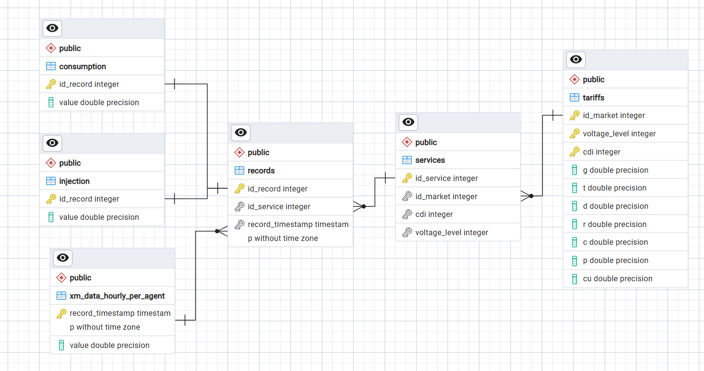

# ⚡ API de Facturación de Energía y Análisis de Carga

Este proyecto es una solución integral que abarca desde el modelado y poblamiento de una base de datos relacional en **PostgreSQL**, pasando por la implementación de reglas de negocio para la liquidación tarifaria de energía, hasta la exposición de una **API RESTful** construida con **FastAPI**.

---


# 📌 Resumen del Flujo de Trabajo

El desarrollo se realizó de manera secuencial siguiendo las mejores prácticas de ingeniería de software y análisis de datos:

1. **Limpieza y Preparación de Datos (ETL/Data Cleaning):**
   - Análisis exploratorio previo sobre los archivos fuente `.csv`.
   - Normalización de formatos temporales, corrección de coordenadas geográficas y tratamiento de valores nulos o inconsistencias numéricas antes de la carga a base de datos.

2. **Modelado e Importación en PostgreSQL:**
   - Construcción del esquema relacional (6 tablas: `records`, `services`, `tariffs`, `consumption`, `injection`, `xm_data_hourly_per_agent`).
   - Definición de llaves primarias, foráneas e índices para optimizar las consultas de grandes volúmenes de series de tiempo.
   - Importación de los datos limpios desde los archivos `.csv` a las tablas correspondientes.
   - -la base de datos creada está disponible para su uso; consultar: base_datos_energia.sql 

3. **Lógica de Negocio y Consultas Complejas en Python:**
   - Creación de scripts en Python utilizando **SQLAlchemy** y **Pandas** para ejecutar consultas optimizadas con `JOIN` y `LEFT JOIN`.
   - Implementación de la lógica de facturación de energía según la reglamentación aplicable:
     - **EA (Energía Activa):** Liquidación del consumo base.
     - **EC (Excedentes de Comercialización):** Liquidación de la inyección base.
     - **EE1 y EE2 (Excedentes Tipo 1 y Tipo 2):** Algoritmo acumulativo por hora cruzado con el precio de bolsa de energía (XM).

4. **Desarrollo y Exposición de la API con FastAPI:**
   - Construcción de endpoints `POST` y `GET` para consultar facturas, evaluar conceptos específicos, obtener métricas por cliente y consultar la curva de carga horaria del sistema.
   - Integración de validaciones robustas con **Pydantic** y listas desplegables `Enum` para facilitar la interacción desde Swagger UI.

---

## 🚀 Arquitectura de Endpoints (API)

| Método | Endpoint | Descripción |
| :--- | :--- | :--- |
| `POST` | `/calculate-invoice` | Liquidación completa detallada de la factura (EA, EC, EE1, EE2 y Total Neto). |
| `POST` | `/calculate-concept` | Liquidación independiente de un concepto tarifario específico (`EA`, `EC`, `EE1`, `EE2` o `TOTAL`). |
| `GET` | `/client-statistics/{service_id}` | Métricas y estadísticas de consumo e inyección filtrables por año y mes. |
| `GET` | `/system-load` | Perfil horaria de carga del sistema (franja de 0 a 23 horas) agregada a nivel global. |

---

# 🚀 Guía Rápida de Ejecución

Sigue estos pasos resumidos para poner a correr el proyecto en tu entorno local:

---

### 1. Preparar la Base de Datos (PostgreSQL)
1. Asegúrate de tener instalado **PostgreSQL** y **pgAdmin**.
2. Abre pgAdmin y **crea una base de datos nueva** (ej. `bd_facturacion`).
3. Haz clic derecho sobre la base de datos creada, selecciona **Restore...** (Restaurar) e importa el archivo `esquema_base_datos.sql` incluido en el repositorio para cargar las tablas y los datos.

---

### 2. Configurar el Entorno de Python
Abre una terminal (PowerShell o CMD) en la raíz del proyecto dentro de Visual Studio Code:

```bash
# Crear y activar entorno virtual (opcional pero recomendado)
python -m venv venv
.\venv\Scripts\activate

# Instalar dependencias requeridas
pip install -r requirements.txt
```

---

### 3. Probar Funciones Locales (Opcional)
Puedes verificar el funcionamiento de las consultas y la lógica de negocio ejecutando los scripts de prueba:
```bash
python funcion_conceptos_factura.py
python pruebas_factura.py
```

---

### 4. Iniciar el Servidor de la API (FastAPI)
En la terminal de PowerShell dentro de VS Code, ejecuta el servidor ASGI **Uvicorn** en el puerto 8000:

```bash
python -m uvicorn main:app --reload --port 8000
```

---

### 5. Interactuar con la API
Una vez que la terminal indique que el servidor está corriendo en `http://127.0.0.1:8000`:

1. Abre tu navegador web y entra a la interfaz interactiva:
   👉 **[http://127.0.0.1:8000/docs](http://127.0.0.1:8000/docs)**
2. Desde la interfaz de **Swagger UI** podrás probar interactivamente los distintos endpoints:
   - **`POST`**: Calcular factura completa (`/calculate-invoice`) o conceptos individuales (`/calculate-concept`).
   - **`GET`**: Consultar estadísticas por cliente (`/client-statistics/{service_id}`) y perfil de carga del sistema (`/system-load`).
